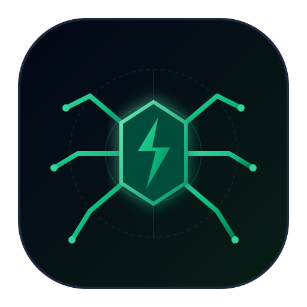
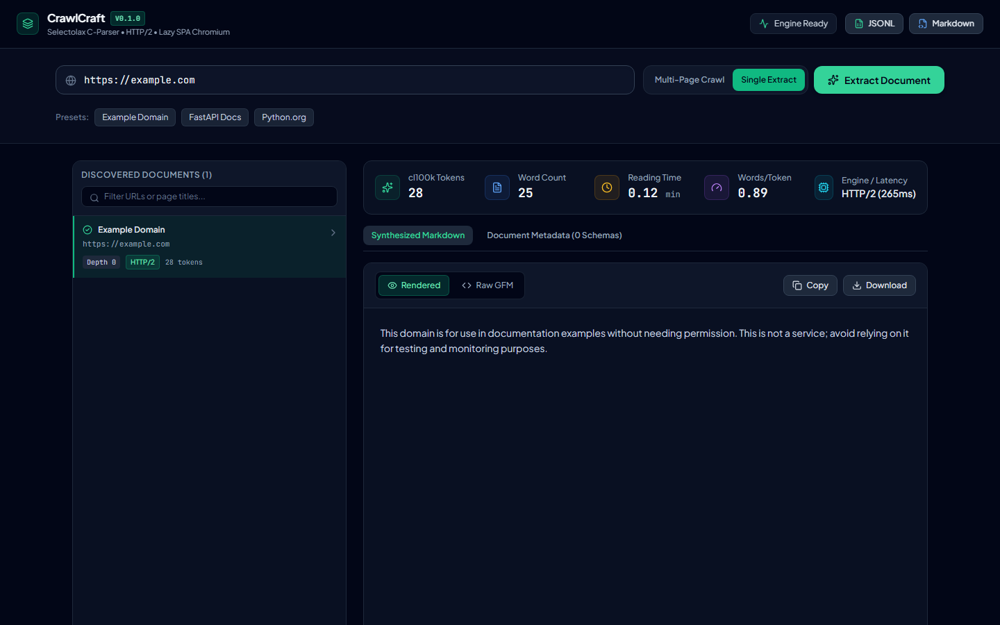
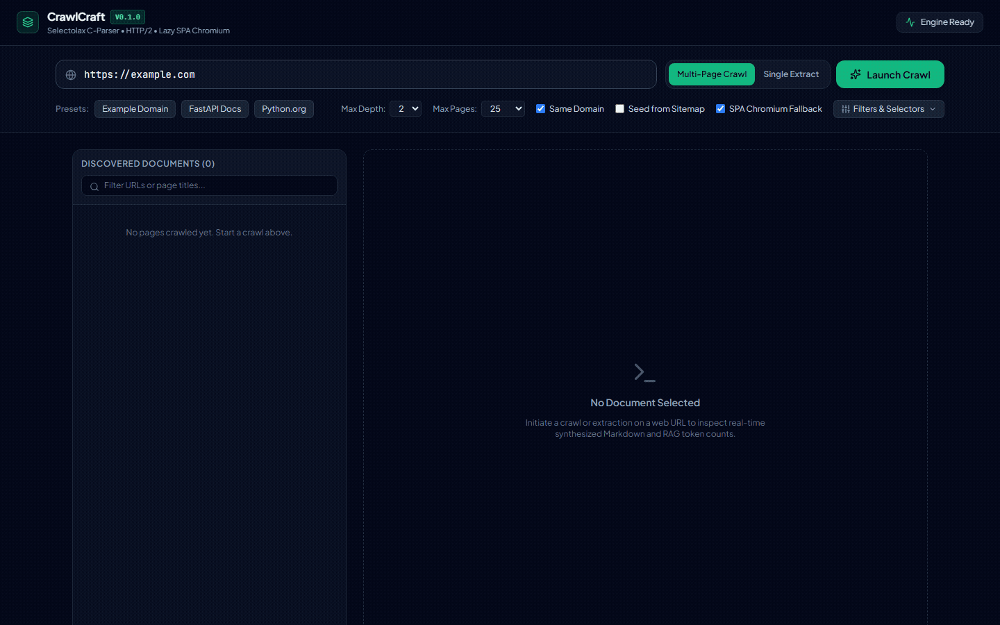

<div align="center">
  
  <h1>CrawlCraft</h1>
  <p><strong>Headless-free asynchronous web crawler and semantic markdown synthesizer for LLM knowledge bases and RAG pipelines.</strong></p>

  <p>
    <a href="https://github.com/alexandrmotologa/crawlcraft/actions"></a>
    <a href="https://python.org"></a>
    <a href="https://react.dev"></a>
    <a href="https://fastapi.tiangolo.com"></a>
    <a href="https://github.com/alexandrmotologa/crawlcraft/blob/main/LICENSE"></a>
  </p>
</div>

---

## Overview

Ingesting clean web text for Retrieval-Augmented Generation (RAG) pipelines and LLM agents usually forces a tradeoff between two approaches:
1. Cloud scraper services that bill on recurring subscriptions per API credit.
2. Full headless browser automation (Playwright or Puppeteer) that uses substantial RAM per tab and introduces latency on static pages.

CrawlCraft provides a local alternative. It runs an asynchronous HTTP/2 network engine coupled to a C-based HTML parser (Selectolax / Lexbor) that processes pages in under 1 millisecond. It parses semantic content, strips advertisements and cookie banners, preserves tables and syntax-highlighted code blocks, extracts structured metadata (JSON-LD, OpenGraph), and computes exact token counts (`cl100k_base`). A headless Chromium browser instance is only launched when the engine detects an empty Single Page Application (SPA) shell requiring client-side JavaScript execution.

---

## Live Studio & Architecture



```
+-----------------------------------------------------------------------------------+
|                                    CRAWLCRAFT                                     |
+-----------------------------------------+-----------------------------------------+
                                          |
        +---------------------------------+---------------------------------+
        |                                                                   |
+-------v-------------------------+                 +-----------------------v-------+
|   Async HTTP/2 Crawler Engine   |                 |     SPA Fallback Worker       |
|  * Asyncio + HTTPX Concurrency  |                 |  * Playwright Headless Lazy   |
|  * Robots.txt & Token Bucket    |                 |  * DOM Hydration Detection    |
|  * Bounded BFS / Domain Scoping |                 |  * Anti-Bot Header Rotation   |
+-------+-------------------------+                 +-----------------------+-------+
        |                                                                   |
        +---------------------------------+---------------------------------+
                                          |
                        +-----------------v-----------------+
                        |   Semantic Markdown Synthesizer   |
                        |  * C-Based HTML5 (Selectolax)     |
                        |  * Boilerplate & Ad Removal       |
                        |  * Table & Code Block Fidelity    |
                        +-----------------+-----------------+
                                          |
                        +-----------------v-----------------+
                        |   Metadata & Token Estimator      |
                        |  * JSON-LD & OpenGraph Extractor  |
                        |  * Tiktoken cl100k_base Counter   |
                        |  * SimHash Content Deduplication  |
                        +-----------------+-----------------+
                                          |
                        +-----------------v-----------------+
                        |   Local REST API & Web Studio     |
                        |  * FastAPI + SSE Live Stream      |
                        |  * Markdown Preview & Diff        |
                        |  * Directory & JSONL Exporter     |
                        +-----------------------------------+
```

---

## Animated Demonstration



---

## Performance

Benchmarking C-based Selectolax parsing against full headless browser execution on the identical HTML payload (tested on 3.8 GHz AMD Ryzen, Windows 11):

| Pipeline | Average Latency | Throughput | Notes |
|:---|:---:|:---:|:---|
| **CrawlCraft Selectolax Engine** | **0.53 ms** | **~1,890 pages/sec/core** | Direct C-tree DOM traversal, memory footprint < 15MB |
| **Playwright Chromium Headless** | 857.58 ms | ~1.2 pages/sec/core | Full V8 execution, DOM tree allocation, GPU emulation |

*Result: The C-based parser completes document conversion ~1,600 times faster than full headless browser instantiation.*

---

## Key Features

- **Dual-Engine Routing**: Runs HTTP/2 requests with realistic browser header rotation by default. Analyzes DOM text density and known framework mount roots (`#root`, `#app`, `#__next`) to identify unhydrated pages, deploying Chromium only when JavaScript is required.
- **GFM Table and Code Preservation**: Converts HTML tables to aligned GitHub Flavored Markdown tables with cell sanitization. Extracts programming language classes (`language-python`, `lang-ts`) on code blocks.
- **Noise and Banner Stripping**: Decomposes cookie consent dialogs, newsletter subscription boxes, tracking pixels, navigation menus, and footers.
- **RAG Metadata and Token Estimation**: Parses Schema.org JSON-LD scripts, OpenGraph attributes, Dublin Core elements, and computes exact token counts using `tiktoken` (`cl100k_base` model encoding).
- **Near-Duplicate Detection**: Implements 64-bit SimHash fingerprints with Hamming distance comparisons to avoid re-indexing duplicated or slightly modified pages.
- **Polite Crawling**: Per-domain token bucket rate limiting prevents target server saturation. Asynchronous robots.txt manager respects Allow and Disallow rules.
- **Interactive Web Studio**: Built with React 19, TypeScript, and Vite. Streams real-time crawling metrics and page events via Server-Sent Events (SSE).

---

## Installation

### Prerequisites
- Python 3.12 or later
- Node.js 18+ (for modifying or rebuilding the web interface)

```bash
# Clone the repository
git clone https://github.com/alexandrmotologa/crawlcraft.git
cd crawlcraft

# Create and activate virtual environment
python -m venv .venv
source .venv/bin/activate  # On Windows: .\.venv\Scripts\Activate.ps1

# Install package dependencies
pip install -e .

# Install headless browser binaries for SPA fallback
playwright install chromium
```

---

## Usage

### 1. Command-Line Interface (CLI)

#### Single Page Extraction
Convert any web page or documentation article into clean Markdown:
```bash
crawlcraft extract "https://docs.python.org/3/tutorial/index.html" -o tutorial.md
```

#### Multi-Page Bounded Crawl
Run a bounded BFS crawl with concurrency caps and export directly to JSONL:
```bash
crawlcraft crawl "https://example.com" --depth 2 --max-pages 50 --concurrency 8 --output dataset.jsonl
```

#### Speed Benchmark
Measure processing latency between HTTP/2 C-parsing and headless Chromium on a specific URL:
```bash
crawlcraft benchmark "https://example.com" --iterations 5
```

---

### 2. Running the REST API & Web Studio

Start the FastAPI daemon:
```bash
crawlcraft serve --host 127.0.0.1 --port 8000
```

Open `http://localhost:8000` in your browser to access the React 19 studio interface.

#### REST API Endpoints

- **`POST /v1/extract`**: Synchronous extraction for a single URL or raw HTML string.
```bash
curl -X POST "http://127.0.0.1:8000/v1/extract" \
  -H "Content-Type: application/json" \
  -d '{"url": "https://example.com", "allow_spa_fallback": true}'
```

- **`POST /v1/crawl`**: Start an asynchronous multi-page crawl job. Returns a `job_id`.
```bash
curl -X POST "http://127.0.0.1:8000/v1/crawl" \
  -H "Content-Type: application/json" \
  -d '{"urls": ["https://example.com"], "max_depth": 2, "max_pages": 20, "concurrency": 6}'
```

- **`GET /v1/crawl/{job_id}/stream`**: Server-Sent Events stream emitting pages as they finish crawling.
- **`GET /v1/crawl/{job_id}/export?format=jsonl`**: Download the full crawl dataset.
- **`GET /v1/health`**: Healthcheck and system capability diagnostics.

---

### 3. Python Library Usage

```python
import asyncio
from crawlcraft.core.crawler import AsyncCrawler, CrawlConfig
from crawlcraft.extractor.markdown import html_to_markdown
from crawlcraft.extractor.metadata import extract_metadata

# Direct HTML to Markdown conversion
html = "<h1>Title</h1><p>Sample paragraph with a <a href='/link'>relative link</a>.</p>"
markdown = html_to_markdown(html, base_url="https://example.com")
metadata = extract_metadata(html, url="https://example.com", text_content=markdown)

print("Markdown:", markdown)
print("Token count:", metadata.token_stats["token_count"])

# Programmatic Crawler execution
async def run_crawler():
    config = CrawlConfig(
        start_urls=["https://example.com"],
        max_depth=2,
        max_pages=20,
        concurrency=4,
        requests_per_second=5.0,
    )
    crawler = AsyncCrawler(config)
    pages = await crawler.run()
    for page in pages:
        print(f"Crawled: {page.url} ({page.metadata.token_stats['token_count']} tokens)")

asyncio.run(run_crawler())
```

---

## Test Suite

Run the automated test suite with pytest:
```bash
pytest -v
```

The test suite covers:
- HTML cleaning, ad pruning, and structural boilerplate removal.
- GFM table parsing, code block language retention, and LaTeX math protection.
- OpenGraph tags, Dublin Core, and Schema.org JSON-LD extraction.
- Tiktoken `cl100k_base` estimation accuracy.
- SPA detection heuristics on empty root elements.
- URL parameter normalization and 64-bit SimHash Hamming distance checks.
- FastAPI endpoints, background tasks, and health probes.

---

## License

This project is distributed under the [MIT License](LICENSE).
